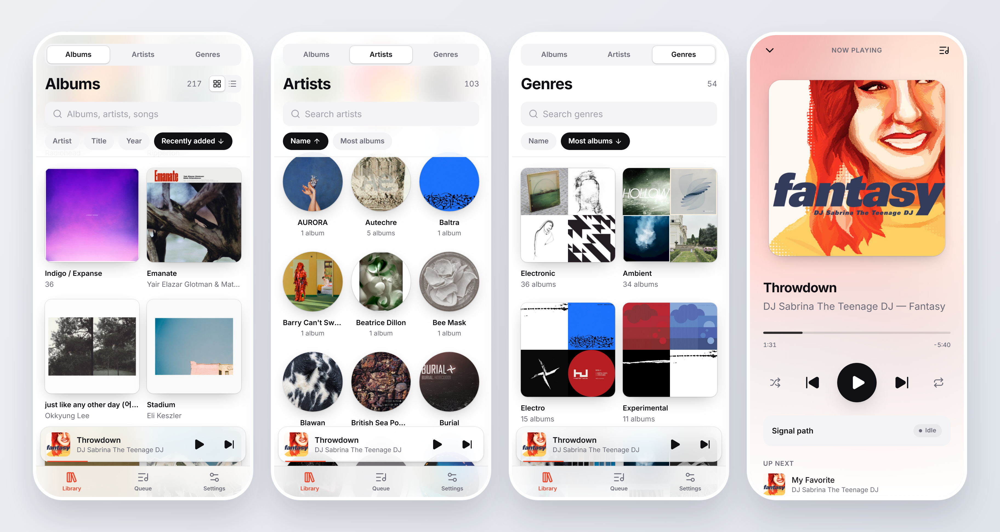

# Virgil

A headless, bit-perfect music player for a Raspberry Pi with a HiFiBerry Digi2 Pro:
a fast web UI for your local library, plus AirPlay 2 (multi-room, no subscription).

<p align="center">
  <picture>
    <source media="(prefers-color-scheme: dark)" srcset="docs/screenshots/phones-dark.png">
    
  </picture>
</p>

```sh
docker pull ghcr.io/kiesxoxo/virgil:0.3.3
```

**On a Windows PC**, download `Virgil.exe` from the [latest release](https://github.com/kiesxoxo/virgil/releases/latest)
and run it. It's one file: the official `mpd.exe` is inside and unpacks to `%LOCALAPPDATA%\Virgil`.
Virgil plays to the device you pick in Settings (headphone amp, USB DAC, S/PDIF) in WASAPI
exclusive mode, so Windows' mixer never touches the audio, and runs in its own window (WebView2,
built into Windows). Closing the window quits Virgil. Set the music folder (a local folder or a
share like `\\nas\Music`) in Settings.

```
 phone / laptop ──HTTP + WebSocket──▶ virgild (Rust) ──MPD protocol──▶ MPD ──hw:──▶ Digi2 Pro ──S/PDIF──▶ DAC
                                        │    ▲
                    shairport-sync ─────┘    └── /proc/asound/…/hw_params (signal path)
                    (AirPlay 2, hooks)
```

- **MPD** decodes and plays: gapless playback, per-track format switching, DoP, straight to `hw:`.
- **virgild** owns everything else: the library index (SQLite + FTS5), artwork thumbnails, the
  queue UI, live state over WebSocket, and who gets the DAC (local playback vs AirPlay).
- **Web UI**: SvelteKit 3 (Svelte 5) SPA, embedded in the virgild binary. Browse by album,
  artist or genre, search songs, edit tags foobar2000-style. Light and dark mode, built for
  phones first; installable to the home screen.

## Bit-perfect, verified

MPD sends audio to `hw:CARD=sndrpihifiberry` with no mixer, resampler or format conversion
([deploy/mpd.conf](deploy/mpd.conf)). virgild then *checks* it: twice a second it compares MPD's
decoder format with what ALSA reports the card is receiving and shows the verdict in the UI:

| Badge | Meaning |
|---|---|
| **Bit-perfect** | Same rate and channels; bit depth equal or zero-padded (16-bit in a 32-bit frame is still exact). |
| **Bit-perfect · DoP** | DSD64 carried as DoP at 176.4 kHz. |
| **Resampled** | The file exceeds the Digi2 Pro (above 192 kHz), so MPD's soxr downsampled it. |
| **Converted** | Float source, channel change or truncation. |
| **AirPlay** | AirPlay owns the DAC: synchronized across rooms, by design not bit-perfect. |

Volume is never touched in software: set it on your DAC or amp.

## AirPlay and the DAC

`hw:` devices are exclusive, so exactly one source may hold the DAC:

1. An iPhone starts AirPlay → shairport-sync runs `virgild ctl acquire airplay` → virgild stops MPD
   (remembering the position), waits until ALSA reports the device closed, and returns.
2. The session ends → `virgild ctl release airplay`.
3. You press play in the web UI during AirPlay → virgild calls shairport-sync's D-Bus
   `DropSession`, waits for the DAC, then plays (resuming where AirPlay interrupted).

Each Pi is an ordinary AirPlay 2 speaker; group rooms from Control Center on the iPhone or Mac.

## Layout

```
crates/core        wire types; `cargo test -p virgil-core` regenerates web/src/lib/types/*.ts
crates/engine-mpd  MPD protocol client and typed commands (the playback-engine seam)
crates/library     MPD database → SQLite projection, search, artwork cache
crates/virgild       the daemon: HTTP API, WebSocket, DAC arbitration, signal path, embedded UI
web/               SvelteKit 3 app (Tailwind 4, Lucide icons)
deploy/            native install: mpd.conf, shairport-sync.conf, virgild.toml, systemd unit, boot config
docker/            container install: compose.yaml, entrypoint, AirPlay config and D-Bus policy
scripts/           cross-build and deploy helpers
```

## Develop (WSL or Linux)

Needs Rust (stable), Node 22.17+, and for Pi builds [zig](https://ziglang.org) +
[cargo-zigbuild](https://github.com/rust-cross/cargo-zigbuild).

```bash
cargo test --workspace                  # also regenerates the TypeScript types
scripts/dev.sh                          # MPD + a generated test library + virgild on :8080
```

`scripts/dev.sh` needs `mpd`, `flac` and `python3` (`sudo apt install mpd flac`). It builds a
small FLAC library in `~/virgil-dev` (silent audio, real tags, 16/44.1 up to 24/192, folder and
embedded artwork, a multi-disc album and an untagged compilation) and plays through MPD's null
output. Without a DAC the signal path reads *Unverified*; everything else behaves as on the Pi.

For UI work, run `npm run dev` in `web/` with virgild running (it proxies `/api` and `/art`).
Point it at the Pi instead with `VIRGIL_URL=http://virgil.local npm run dev`.

Debug builds read `web/build` from disk, so `npm run build` + refresh is enough; release builds
embed it.

## Install on the Pi with Docker (recommended)

[`ghcr.io/kiesxoxo/virgil`](https://github.com/kiesxoxo/virgil/pkgs/container/virgil) (linux/arm64 and
linux/amd64) bundles virgild and MPD and is rebuilt by CI on every push to `main`. AirPlay 2 runs next
to it in the official [`mikebrady/shairport-sync`](https://hub.docker.com/r/mikebrady/shairport-sync)
image. [docker/compose.yaml](docker/compose.yaml) wires the two together.

On **Raspberry Pi OS Lite (64-bit)**:

1. Append [deploy/config.txt](deploy/config.txt) to `/boot/firmware/config.txt`, reboot, and check
   `cat /proc/asound/cards` lists `sndrpihifiberry`.
2. Install Docker: `curl -fsSL https://get.docker.com | sh`, then `sudo usermod -aG docker $USER`
   and log in again.
3. Let the AirPlay container publish its D-Bus interface on the Pi's bus (Virgil uses it to end an
   AirPlay session when you press play):

   ```bash
   sudo curl -fsSL -o /etc/dbus-1/system.d/shairport-sync-dbus.conf \
     https://raw.githubusercontent.com/kiesxoxo/virgil/main/docker/shairport-sync-dbus.conf
   sudo systemctl reload dbus
   ```

4. Fetch the compose file and AirPlay config, set your music folder in `compose.yaml`
   (`/mnt/music` by default), and start:

   ```bash
   mkdir -p ~/virgil && cd ~/virgil
   curl -fsSLO https://raw.githubusercontent.com/kiesxoxo/virgil/main/docker/compose.yaml
   curl -fsSLO https://raw.githubusercontent.com/kiesxoxo/virgil/main/docker/shairport-sync.conf
   docker compose up -d
   ```

5. Open `http://<hostname>.local/` on your phone and *Add to Home Screen*.

Update with `docker compose pull && docker compose up -d`. If the Pi has no internet access, push
the image from your computer instead (`scripts/push-image.sh user@pi`), then run
`docker compose up -d --pull never` on the Pi.

Music on a NAS: mount the share on the Pi at `/mnt/music`, e.g. with this `/etc/fstab` line and a
`credentials` file holding `username=` and `password=` (mode 600):

```
//nas/share/Music  /mnt/music  cifs  credentials=/etc/samba/credentials-nas,ro,iocharset=utf8,nofail,_netdev  0  0
```

The bind in `compose.yaml` uses `propagation: rslave`, so the share shows up even when it is
mounted after the container started. Network shares send no change notifications: use *Rescan*
in Settings after adding music.

Settings live in `compose.yaml`:

| Variable | Default | |
|---|---|---|
| `VIRGIL_PORT` | `80` | Web UI port (also change it in `shairport-sync.conf`'s hooks) |
| `ALSA_CARD` | `sndrpihifiberry` | DAC card id from `cat /proc/asound/cards` |
| `MPD_DOP` | `yes` | DSD64 as DoP; `no` if your DAC does not accept DoP |
| `AIRPLAY` | `on` | `off` if you run Virgil without the shairport-sync container |

To take full control, mount your own `/config/mpd.conf` and/or `/config/virgild.toml` into the
`virgil` container. Both containers use host networking (AirPlay 2, mDNS and NQPTP need it) and the
Pi's own avahi-daemon. Don't also run MPD or shairport-sync natively: only one program can hold
the DAC.

Use wired Ethernet: Wi-Fi power saving causes AirPlay dropouts.

## Install on the Pi natively

On **Raspberry Pi OS Lite (64-bit)**:

1. Append [deploy/config.txt](deploy/config.txt) to `/boot/firmware/config.txt`, reboot, and check
   `cat /proc/asound/cards` lists `sndrpihifiberry`.
2. `sudo apt install mpd` and mount your music at `/mnt/music` (or change `music_directory`).
3. AirPlay 2: copy `deploy/` to the Pi and run `deploy/install-airplay2.sh` (builds NQPTP and
   shairport-sync with AirPlay 2 and D-Bus support, installs the config, enables both).
4. From your dev machine:

   ```bash
   scripts/build-pi.sh
   scripts/deploy.sh pi@virgil.local --configs
   ```

5. Open `http://<hostname>.local/` on your phone and *Add to Home Screen*.

## API

All commands are plain HTTP; state changes arrive on `GET /api/ws` (`hello` first, then deltas).

```
POST   /api/player/{play,pause,toggle,stop,next,previous}
POST   /api/player/seek            {"seconds": 42}
POST   /api/player/modes           {"repeat": true, "random": false, "single": false, "consume": false}
GET    /api/queue
POST   /api/queue                  {"album": "<id>", "uris": [], "mode": "append|next|replace", "play": true, "start": "<uri>"}
DELETE /api/queue                  (clear)
DELETE /api/queue/{id}
POST   /api/queue/{id}/play
POST   /api/queue/{id}/move        {"to": 3}
GET    /api/library                 counts, scan status, revision
GET    /api/library/albums          all albums (ETag = revision)
GET    /api/library/albums/{id}
GET    /api/library/search?q=…
POST   /api/library/rescan
POST   /api/sources/{name}/{acquire,release}
GET    /art/{key}-{300,600}.jpg     immutable
```

The API has no authentication; keep the Pi on a trusted network.
