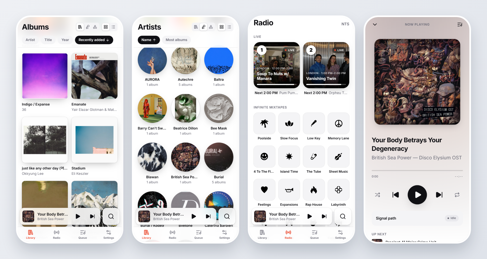
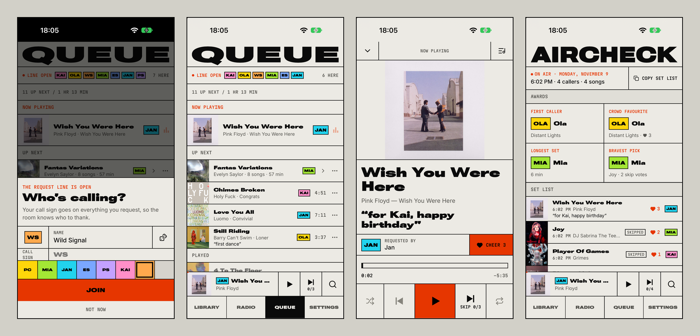
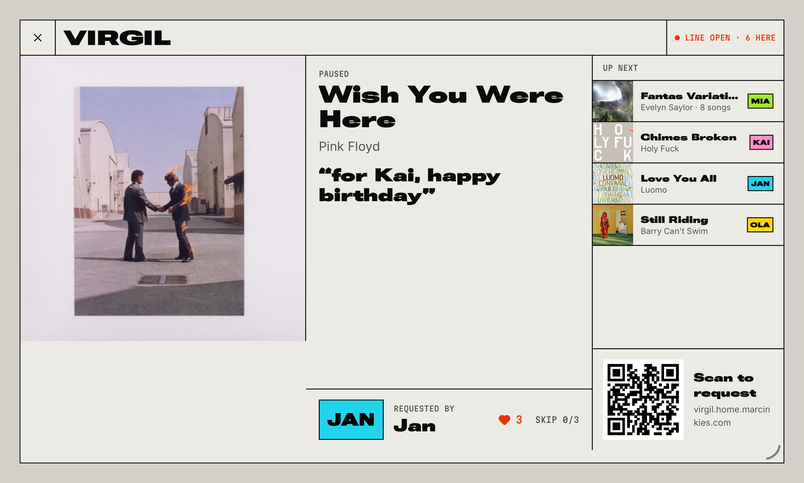

# Virgil

A headless, bit-perfect music player for a Raspberry Pi with a HiFiBerry Digi2 Pro:
a fast web UI for your local library, NTS Radio's live channels and Infinite Mixtapes, plus
AirPlay 2 (multi-room, no subscription).

<p align="center">
  <picture>
    <source media="(prefers-color-scheme: dark)" srcset="docs/screenshots/phones-dark.png">
    
  </picture>
</p>

```sh
docker pull ghcr.io/kiesxoxo/virgil:0.15.0
```

```
 phone / laptop ──HTTP + WebSocket──▶ virgild (Rust) ──MPD protocol──▶ MPD ──hw:──▶ Digi2 Pro ──S/PDIF──▶ DAC
                                        │    ▲
                    shairport-sync ─────┘    └── /proc/asound/…/hw_params (signal path)
                    (AirPlay 2, hooks)
```

- **MPD** decodes and plays: gapless playback, per-track format switching, DoP, straight to `hw:`.
- **virgild** owns everything else: the library index (SQLite + FTS5), artwork thumbnails, the
  queue UI, live state over WebSocket, what's on NTS, and who gets the DAC (local playback vs AirPlay).
- **Web UI**: SvelteKit 3 (Svelte 5) SPA, embedded in the virgild binary. Browse by album,
  artist or genre, search songs. Light and dark mode, built for phones first; installable to the
  home screen.
- **The music** is only read. Tags, covers and files are another tool's job (Lidarr, say): covers
  come from a `cover.*` image in the album folder or a picture embedded in the files, as MPD reads them.
  With Lidarr set up, Virgil can still ask for music it doesn't have (see [Downloads](#downloads)).

## Bit-perfect, verified

MPD sends audio to `hw:CARD=sndrpihifiberry` with no mixer, resampler or format conversion
([deploy/mpd.conf](deploy/mpd.conf)). virgild then *checks* it: twice a second it compares MPD's
decoder format with what ALSA reports the card is receiving and shows the verdict in the UI:

| Badge | Meaning |
|---|---|
| **Bit-perfect** | Same rate and channels; bit depth equal or zero-padded (16-bit in a 32-bit frame is still exact). |
| **Bit-perfect · DoP** | DSD64 carried as DoP at 176.4 kHz. |
| **Resampled** | The file exceeds the Digi2 Pro (above 192 kHz), so MPD's soxr downsampled it. |
| **Converted** | Float source, channel change or truncation. |
| **AirPlay** | AirPlay owns the DAC: synchronized across rooms, by design not bit-perfect. |

Volume is never touched in software: set it on your DAC or amp.

## NTS Radio

The Radio tab is laid out like Atonemo's NTS Radio Player: NTS 1 and
NTS 2 with the show on air (artwork, host location, times, what's next), and the sixteen Infinite
Mixtapes as a grid of their icons. A station plays right after the current song, so skipping
forward carries on with your queue; picking another station replaces it rather than piling up.
Play/pause stops a stream and starts it again live.

The schedule comes from NTS's public API through virgild, which caches it until the show on air
ends. NTS 1 and NTS 2 play NTS's 256 kbps MP3 streams. The mixtapes play as 256 kbps AAC: NTS
serves those as HLS, which MPD can't play, so virgild fetches the chunks (over HTTPS, certificates
checked) and hands MPD one continuous AAC stream on `127.0.0.1`. Either way the source is lossy; the
signal path still checks the last step to the DAC. Radio needs the Pi to reach the internet.

## AirPlay and the DAC

`hw:` devices are exclusive, so exactly one source may hold the DAC:

1. An iPhone starts AirPlay → shairport-sync runs `virgild ctl acquire airplay` → virgild stops MPD
   (remembering the position), waits until ALSA reports the device closed, and returns.
2. The session ends → `virgild ctl release airplay`.
3. You press play in the web UI during AirPlay → virgild calls shairport-sync's D-Bus
   `DropSession`, waits for the DAC, then plays (resuming where AirPlay interrupted).

Each Pi is an ordinary AirPlay 2 speaker; group rooms from Control Center on the iPhone or Mac.

## Apple Home and Siri

virgild is also a HomeKit accessory: a switch named *Virgil* that is on while anything plays (the
library, radio or AirPlay). "Hey Siri, turn off Virgil" pauses the library, stops radio and ends an
AirPlay session; "turn on Virgil" resumes where it left off. It works from a HomePod and in scenes
and automations too, through your home hub.

To add it, open *Settings › Apple Home* in the web UI on your iPhone and tap *Add to Home*, or in
the Home app choose *Add Accessory › More options…* and enter the setup code shown there. The
Home app warns that it is uncertified; add it anyway. Rename it or put it in a room in the Home app.

virgild speaks HAP (HomeKit Accessory Protocol) on TCP port 51827 itself, and advertises through
the Pi's avahi-daemon over D-Bus. If the accessory was removed from the Home app while Virgil was
offline, use *Reset* in Settings so it can be added again.

## The request line

Friends can queue music from their own phones. Open the line from the Queue page (the phone key) or
*Settings › Request line*; guests scan its QR code, say who's calling, and get a **call sign**, their
letters on a square of their colour, which marks everything they request.

<p align="center">
  <picture>
    <source media="(prefers-color-scheme: dark)" srcset="docs/screenshots/request-line-dark.png">
    
  </picture>
</p>

- **Requests take turns.** Each request is one turn, one per person per round, so nobody's album
  buries everyone else's songs. An album stays whole and shows in the queue as one block.
- **Hosts and guests.** Devices that were using Virgil before the line opened are hosts and keep every
  control. Guests request, take back their own requests, cheer, and vote to skip (half the room, at
  least two); whoever picked a song can always skip it. Hosts choose the rules: take turns or not,
  whether guests may pause, and how skipping works. While the line is open nothing replaces the
  queue: PLAY becomes REQUEST, and hosts' menus add *Play now*.
- **Dedications** come with a request and show big on Now Playing when it comes on.
- **Big screen** (`/screen`) is for an iPad on a stand: what's on, who asked for it, what's next,
  and the code to scan.
- **Aircheck** (`/aircheck`) is the night's set list, with who picked what and a few awards, and copies
  as text for the group chat.

<p align="center">
  <picture>
    <source media="(prefers-color-scheme: dark)" srcset="docs/screenshots/big-screen-dark.png">
    
  </picture>
</p>

Who picked what is kept in `party.json` in the data directory, and survives restarts of MPD and
Virgil. There are no passwords: like the rest of the API, it trusts the network it is on.

## Downloads

With [Lidarr](https://lidarr.audio) set up, Virgil can get music the library doesn't have, and
with [slskdpp](https://github.com/kiesxoxo/slskdpp) single songs too. Virgil still never writes to
the music: Lidarr finds, tags, names and files everything, and Virgil rescans the folder once it's in
(a network share tells MPD nothing).

- **Search** the library (albums or artists) and, below the results, *Find “…” to download* looks
  the words up in Lidarr's catalogue (MusicBrainz, through Lidarr's metadata server): artists and
  albums. An artist Lidarr doesn't follow yet shows their albums once you ask (*Show their albums*
  adds them to Lidarr, wanting nothing).
- **Artist pages** list *Not in library*: the albums Lidarr knows by them that you have none of.
- **Album pages** list the songs that are *Missing*, when Lidarr says the album has more.

An album downloads whole: Lidarr adds it (and its artist, set to want only this album), searches its
indexers (Soulseek through slskdpp, torrents, whatever it has) and grabs the best release for its
quality profile. Lidarr only deals in albums, so a single song comes from Soulseek: slskdpp searches,
Virgil picks the file (the title, the length within three seconds, the formats you allow, the album's
own folder, then a free slot and a fast connection), and Lidarr's manual import files it into its
album. Anyone may start a download, guests on the request line too; *Settings › Downloads* shows how
each is going. Downloads are kept in `downloads.json` in the data directory and pick up where they
were after a restart.

Lidarr's root folder has to be the folder MPD plays from, under any name, and Lidarr has to see
slskdpp's downloads (its remote path mapping for slskdpp). For Docker, set in `compose.yaml`:

| Variable | |
|---|---|
| `LIDARR_URL` | e.g. `http://nas:8686`; downloads are off without it |
| `LIDARR_API_KEY` | Lidarr › Settings › General › API Key |
| `LIDARR_ROOT` | Lidarr's root folder for this library, if it has more than one |
| `SLSKDPP_URL` | e.g. `http://nas:5030`; single songs are off without it |
| `SLSKDPP_API_KEY` | slskdpp › Settings › API keys |
| `SLSKDPP_DOWNLOADS` | slskdpp's downloads folder as Lidarr sees it, e.g. `/data/Downloads/slskdpp` |
| `SLSKDPP_FORMATS` | file types to take, best first (`flac`; `flac,mp3` for more luck) |

Natively, the `[lidarr]` and `[slskdpp]` sections of [deploy/virgild.toml](deploy/virgild.toml) do the same.

## Layout

```
crates/core        wire types; `cargo test -p virgil-core` regenerates web/src/lib/types/*.ts
crates/engine-mpd  MPD protocol client and typed commands (the playback-engine seam)
crates/library     MPD database → SQLite projection, search, artwork cache
crates/radio       NTS: live channels, Infinite Mixtapes, HLS relay
crates/fetch       Lidarr and slskdpp clients; which Soulseek file is the song
crates/homekit     the Apple Home switch (HAP over IP)
crates/virgild     the daemon: HTTP API, WebSocket, DAC arbitration, signal path, embedded UI
web/               SvelteKit 3 app (Tailwind 4, Lucide icons)
deploy/            native install: mpd.conf, shairport-sync.conf, virgild.toml, systemd unit, boot config
docker/            container install: compose.yaml, entrypoint, AirPlay config and D-Bus policy
scripts/           cross-build and deploy helpers
```

## Develop (WSL or Linux)

Needs Rust (stable), Node 22.17+, and for Pi builds [zig](https://ziglang.org) +
[cargo-zigbuild](https://github.com/rust-cross/cargo-zigbuild).

```bash
cargo test --workspace                  # also regenerates the TypeScript types
scripts/dev.sh                          # MPD + a generated test library + virgild on :8080
```

`scripts/dev.sh` needs `mpd`, `flac` and `python3` (`sudo apt install mpd flac`). It builds a
small FLAC library in `~/virgil-dev` (silent audio, real tags, 16/44.1 up to 24/192, folder and
embedded artwork, a multi-disc album and an untagged compilation) and plays through MPD's null
output. Without a DAC the signal path reads *Unverified*; everything else behaves as on the Pi.

For UI work, run `npm run dev` in `web/` with virgild running (it proxies `/api` and `/art`).
Point it at the Pi instead with `VIRGIL_URL=http://virgil.local npm run dev`.

Debug builds read `web/build` from disk, so `npm run build` + refresh is enough; release builds
embed it.

## Install on the Pi with Docker (recommended)

[`ghcr.io/kiesxoxo/virgil`](https://github.com/kiesxoxo/virgil/pkgs/container/virgil) (linux/arm64 and
linux/amd64) bundles virgild and MPD and is rebuilt by CI on every push to `main`. AirPlay 2 runs next
to it in the official [`mikebrady/shairport-sync`](https://hub.docker.com/r/mikebrady/shairport-sync)
image. [docker/compose.yaml](docker/compose.yaml) wires the two together.

On **Raspberry Pi OS Lite (64-bit)**:

1. Append [deploy/config.txt](deploy/config.txt) to `/boot/firmware/config.txt`, reboot, and check
   `cat /proc/asound/cards` lists `sndrpihifiberry`.
2. Install Docker: `curl -fsSL https://get.docker.com | sh`, then `sudo usermod -aG docker $USER`
   and log in again.
3. Let the AirPlay container publish its D-Bus interface on the Pi's bus (Virgil uses it to end an
   AirPlay session when you press play):

   ```bash
   sudo curl -fsSL -o /etc/dbus-1/system.d/shairport-sync-dbus.conf \
     https://raw.githubusercontent.com/kiesxoxo/virgil/main/docker/shairport-sync-dbus.conf
   sudo systemctl reload dbus
   ```

4. Fetch the compose file and AirPlay config, set your music folder in `compose.yaml`
   (`/mnt/music` by default), and start:

   ```bash
   mkdir -p ~/virgil && cd ~/virgil
   curl -fsSLO https://raw.githubusercontent.com/kiesxoxo/virgil/main/docker/compose.yaml
   curl -fsSLO https://raw.githubusercontent.com/kiesxoxo/virgil/main/docker/shairport-sync.conf
   docker compose up -d
   ```

5. Open `http://<hostname>.local/` on your phone and *Add to Home Screen*.

Update with `docker compose pull && docker compose up -d`. If the Pi has no internet access, push
the image from your computer instead (`scripts/push-image.sh user@pi`), then run
`docker compose up -d --pull never` on the Pi.

Music on a NAS: mount the share on the Pi at `/mnt/music`, e.g. with this `/etc/fstab` line and a
`credentials` file holding `username=` and `password=` (mode 600):

```
//nas/share/Music  /mnt/music  cifs  credentials=/etc/samba/credentials-nas,ro,iocharset=utf8,nofail,_netdev  0  0
```

The bind in `compose.yaml` uses `propagation: rslave`, so the share shows up even when it is
mounted after the container started. Network shares send no change notifications: use *Rescan*
in Settings after adding music.

Settings live in `compose.yaml`:

| Variable | Default | |
|---|---|---|
| `VIRGIL_PORT` | `80` | Web UI port (also change it in `shairport-sync.conf`'s hooks) |
| `ALSA_CARD` | `sndrpihifiberry` | DAC card id from `cat /proc/asound/cards` |
| `MPD_DOP` | `yes` | DSD64 as DoP; `no` if your DAC does not accept DoP |
| `AIRPLAY` | `on` | `off` if you run Virgil without the shairport-sync container |
| `HOMEKIT` | `on` | `off` to keep Virgil out of Apple Home |

To take full control, mount your own `/config/mpd.conf` and/or `/config/virgild.toml` into the
`virgil` container. Both containers use host networking (AirPlay 2, mDNS and NQPTP need it) and the
Pi's own avahi-daemon. Don't also run MPD or shairport-sync natively: only one program can hold
the DAC.

Use wired Ethernet: Wi-Fi power saving causes AirPlay dropouts.

## Install on the Pi natively

On **Raspberry Pi OS Lite (64-bit)**:

1. Append [deploy/config.txt](deploy/config.txt) to `/boot/firmware/config.txt`, reboot, and check
   `cat /proc/asound/cards` lists `sndrpihifiberry`.
2. `sudo apt install mpd` and mount your music at `/mnt/music` (or change `music_directory`).
3. AirPlay 2: copy `deploy/` to the Pi and run `deploy/install-airplay2.sh` (builds NQPTP and
   shairport-sync with AirPlay 2 and D-Bus support, installs the config, enables both).
4. From your dev machine:

   ```bash
   scripts/build-pi.sh
   scripts/deploy.sh pi@virgil.local --configs
   ```

5. Open `http://<hostname>.local/` on your phone and *Add to Home Screen*.

## API

All commands are plain HTTP; state changes arrive on `GET /api/ws` (`hello` first, then deltas).

```
POST   /api/player/{play,pause,toggle,stop,next,previous}
POST   /api/player/seek            {"seconds": 42}
POST   /api/player/modes           {"repeat": true, "random": false, "single": false, "consume": false}
GET    /api/queue
POST   /api/queue                  {"album": "<id>", "uris": [], "mode": "append|next|replace", "play": true, "start": "<uri>", "note": "…"}
DELETE /api/queue                  (clear)
DELETE /api/queue/{id}
POST   /api/queue/{id}/play
POST   /api/queue/{id}/move        {"to": 3}
GET    /api/library                 counts, scan status, revision
GET    /api/library/albums          all albums (ETag = revision)
GET    /api/library/albums/{id}
GET    /api/library/search?q=…
POST   /api/library/rescan
GET    /api/library/albums/{id}/missing   the album as Lidarr has it: every track, `have` or not
GET    /api/catalog/search?q=…            artists and albums in Lidarr's catalogue
GET    /api/catalog/artists/{mbid}        every album Lidarr has of an artist
POST   /api/catalog/artists/{mbid}        the same, having Lidarr follow them (wanting nothing) to list them
GET    /api/catalog/artist?name=…         Lidarr's albums by an artist that the library has none of
GET    /api/catalog/albums/{mbid}         one album (MusicBrainz release group), tracks once Lidarr has it
POST   /api/catalog/albums/{mbid}/tracks  the same, having Lidarr add it (wanting nothing) to read its tracks
GET    /api/downloads
POST   /api/downloads                     {"album": "<mbid>", "track": <Lidarr track id>?}   202
POST   /api/downloads/{id}/retry
DELETE /api/downloads/{id}                (off the list; stops a song's transfer)
DELETE /api/queue/requests/{request}   (what is left of a request)
GET    /api/people/me             PUT {"name", "sign", "color", "join"?}
POST   /api/people/me/link        {"person": "<id>"}
POST   /api/people/{id}/host      {"host": true}
DELETE /api/people/{id}
POST   /api/party                 {"open": true, "rules": {"takeTurns": true, "guestsPause": true, "skip": "vote|free|off"}}
POST   /api/party/{skip,cheer}
GET    /api/party/aircheck
POST   /api/sources/{name}/{acquire,release}
GET    /art/{key}-{300,600,1000}.jpg     immutable
```

Each browser sends a random device token in `x-virgil-token` (`?token=` on the WebSocket); that is
how the request line knows who is who. `POST /api/queue` answers with where the songs landed
(`{"ids", "position", "ahead"}`). The API has no authentication; keep the Pi on a trusted network.
